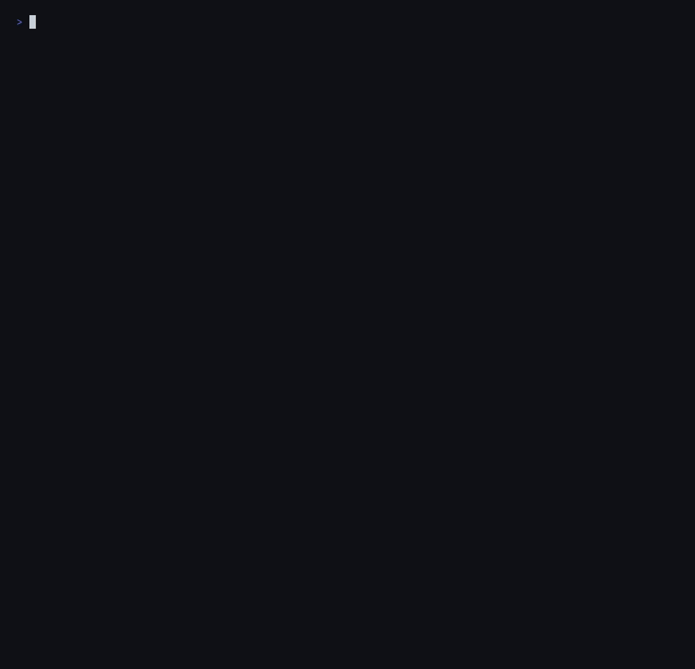
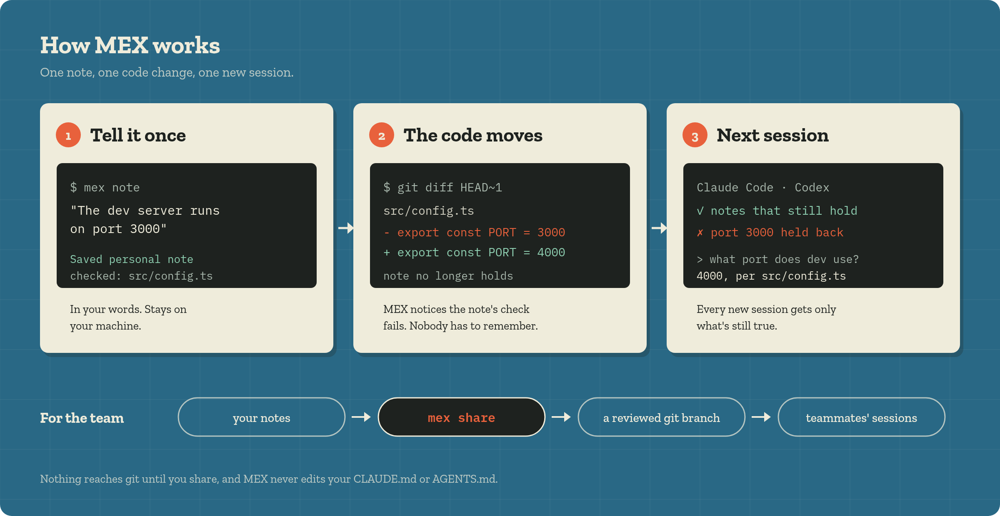

<div align="center">

<h1 id="mex">
  
</h1>

**Díselo una vez a tus agentes. MEX lo mantiene cierto.**

Los agentes olvidan entre sesiones, y las notas que les dejas quedan obsoletas cuando el código cambia. MEX entrega tus notas a cada nueva sesión de Claude Code y Codex, y retiene las que el código ha vuelto falsas.

[English](README.md) | [简体中文](README.zh-CN.md) | **Español** | [Português (Brasil)](README.pt-BR.md)

[](https://www.npmjs.com/package/mex-agent?activeTab=versions)
[](https://www.npmjs.com/package/mex-agent)
[](https://github.com/mex-memory/mex/stargazers)
[](https://mexmemory.com)
[](https://discord.gg/FEdNsQ4Qt4)
[](LICENSE)
[](https://github.com/mex-memory/mex/actions/workflows/ci.yml)
[](package.json)
[](package.json)
[](#install)
[](#install)

[Instalación](#install) · [Qué obtienes](#what-you-get) · [Míralo en acción](#see-it-work) · [Cómo funciona](#how-it-works) · [Comandos](#everyday-commands) · [Equipos](#working-with-a-team) · [Preguntas frecuentes](#faq) · [Actualizar desde 0.8](#upgrading-from-08)

</div>

> [!NOTE]
> **Esto es MEX 0.9 beta**, una versión preliminar en la etiqueta `next` de npm. `npm i mex-agent` sigue instalando 0.8.5.
> La beta es una CLI para **Claude Code y Codex**. No tiene Hub, servidor MCP ni skills.
> ¿Usas 0.8? Consulta el [README de 0.8.5](https://github.com/mex-memory/mex/blob/v0.8.5/README.es.md) y [Actualizar desde 0.8](#upgrading-from-08).

<picture>
  <source media="(prefers-color-scheme: light)" srcset="docs/diagrams/readme/first-run-novu-light.gif">
  
</picture>

<a id="install"></a>
## Instalación

Necesita Node 22.5 o posterior (con `node:sqlite`) en Windows, macOS o Linux, además de Claude Code o Codex.

```sh
npm i -g mex-agent@next
cd your-repo
mex
```

Deshacer: `mex off` (este repo) · `mex uninstall` (todo, conserva las notas)

`mex` instala los hooks de MEX en la configuración de usuario de Claude Code y Codex, lee el repo y muestra lo que tus agentes reciben a partir de ahora. La primera pantalla no hace llamadas a modelos y no añade nada a git.

**Codex:** abre `/hooks` una vez en Codex para revisar y confiar en los hooks de MEX.

Después, cuéntales a tus agentes algo que siempre hacen mal:

```sh
mex note "<something your agents keep getting wrong here, and why>"
# por ejemplo:
mex note "Dates are stored in UTC because the reports job compares them across regions"
```

Inicia una nueva sesión de Claude Code o Codex y pregúntale por ello.

Instálalo de forma global. MEX no instala hooks desde una ejecución puntual con `npx`, porque npm borra esa caché.

<a id="what-you-get"></a>
## Qué obtienes

- **Dilo una vez.** `mex note` guarda un hecho, una regla o una decisión con tus palabras. Llega a cada nueva sesión de Claude Code y Codex, a través del inicio de sesión y de los propios archivos de reglas de cada agente.
- **Nunca información obsoleta.** Cada nota lleva comprobaciones contra el código. Cuando el código vuelve falsa una nota, MEX la retiene. Cuando cambia la evidencia en la que se basa, el agente recibe un puntero al código actual en lugar de la afirmación antigua.
- **En el momento justo.** Un problema conocido de una carpeta aparece cuando el agente lee por primera vez un archivo de ella, una sola vez. Una regla que mencionas de pasada («aquí siempre usamos pnpm») se le repite al agente en ese turno. Los comandos de pruebas y compilación de tu repo llegan al agente sin que tengas que escribirlos.
- **Tú tienes el control.** `mex what` muestra lo que MEX entregó o retuvo en esta sesión. `mex off` lo detiene en un repo. `mex uninstall` restaura tu configuración exactamente y conserva tus notas.

<a id="see-it-work"></a>
## Míralo en acción

<picture>
  <source media="(prefers-color-scheme: light)" srcset="docs/diagrams/readme/claude-session-light.gif">
  
</picture>

Una nota decía que el servidor de desarrollo usa el puerto 3000, y Claude respondió 3000. Después, un commit lo cambió a 4000. En la siguiente sesión, MEX indicó que la nota ya no coincidía con el código y la retuvo. Claude respondió 4000 y señaló que la línea antigua del 3000 estaba desactualizada. Codex, ante la misma pregunta en una ejecución real el 17 de noviembre de 2026, respondió «desconocido» en lugar de repetir 3000. *(Resumen: [plan de lanzamiento](docs/design/0.9.0-release-plan.md).)*

<a id="how-it-works"></a>
## Cómo funciona

<p align="center"></p>

- **Tus notas se quedan en tu máquina.** Cada una se comprueba contra el código, y una nota que el código ha vuelto falsa se retiene.
- **Cada nueva sesión recibe las notas que siguen siendo ciertas**, a través de los propios hooks y archivos de reglas de Claude Code y Codex. Si MEX falla, tu sesión continúa sin cambios.
- **MEX nunca edita tu `CLAUDE.md` ni tu `AGENTS.md`.** Sus propios archivos de reglas quedan ignorados por git hasta que los compartes (consulta las [preguntas frecuentes](#faq)).

<a id="everyday-commands"></a>
## Comandos de uso diario

| Comando | Qué hace |
| --- | --- |
| `mex note "<text>"` | Guarda una nota con tus palabras. Se comprueba contra el código al guardarla. |
| `mex recall <words>` | Busca una nota, sin llamar a ningún modelo. |
| `mex brief` | Muestra lo que recibirá una nueva sesión. |
| `mex what` | Lo que MEX entregó o retuvo en esta sesión. |
| `mex check` | Comprueba qué notas siguen siendo ciertas. Solo lectura, sin IA. |
| `mex check --diff <base>` | Lo mismo para una rama, para pre-push o CI. No guarda nada. |
| `mex edit` · `mex wrong` · `mex forget` | Corrige una nota, retira una incorrecta (conservando el motivo) o descártala. |
| `mex share` | Previsualiza cómo compartir tus notas y archivos de reglas en una nueva rama de git. |
| `mex handoff "<line>"` | Deja un traspaso para la siguiente persona en esta rama. |
| `mex doctor` | Qué está haciendo MEX aquí, y una solución para cada problema que registró. |
| `mex off` · `mex on` | Desactiva o activa MEX en este repo (`--all` para todos los repos, `--for 2h` para pausarlo). |
| `mex uninstall --dry-run` | Lista cada cambio que hizo MEX. Sin `--dry-run` los revierte y conserva tus notas (`--purge` también las borra). |

Ejecuta `mex --help` para ver la lista completa.

### Cuando tu agente ofrece guardar una nota

Cada sesión le pide al agente que conserve con `mex note` los hechos, reglas o decisiones duraderos que menciones. Tu agente te pedirá aprobar ese comando como cualquier otro; MEX no lo aprueba de antemano. Las notas que guarda el agente se etiquetan como `[Claude Code noted, …]` o `[Codex noted, …]` hasta que las edites con `mex edit`. Para guardar tus propias palabras directamente, escribe `mex note: …` en la sesión.

<a id="working-with-a-team"></a>
## Trabajar en equipo

Las notas son personales hasta que las compartes. Compartir es una rama de git que revisas como el código:

```sh
mex share                               # vista previa: una nueva rama con tus notas y archivos de reglas
mex share --apply --expect <rev>        # crea la rama que previsualizaste
mex share --apply --expect <rev> --pr   # además la sube y abre un pull request
```

Tu rama actual no se toca, y no se sube nada sin `--pr`. Cada nota compartida es un archivo Markdown en el PR:

```markdown
<!-- .mex/learned/mx_f5a7ede674674894feeb10b3.md -->
---
mex:
  id: mx_f5a7ede674674894feeb10b3
  kind: rule
  scope:
    - "**"
  source:
    type: person
    ref: mex note 2026-11-18
    quote: apps/api tests use mocha, not jest, despite the root jest.config.js
  evidence: person
  one_line: apps/api tests use mocha, not jest, despite the root jest.config.js
  checks: []
  status: active
  created: 2026-11-18
---
apps/api tests use mocha, not jest, despite the root jest.config.js
```

Una nota con comprobaciones también lista contra qué se comprobó, con hashes de archivo. Los comandos de pruebas y compilación que MEX encontró al configurarse se comparten igual, un archivo cada uno. El mismo PR incluye los archivos de reglas generados: `.claude/rules/mex.md`, un `.claude/rules/mex-area-*.md` para una carpeta que ya tiene su propio `AGENTS.md`, y un nuevo `AGENTS.md` en cada otra carpeta que recibe comandos. También incluye `.mex/config.json`, `.mex/sources.json` y `.mex/native.json`. Tras fusionarse, la sesión de Claude Code o Codex de un compañero recibe las notas del equipo. Cada máquina conserva sus propias bases de datos.

`mex handoff` le deja a la siguiente persona en una rama:
- la rama;
- los nombres de los archivos sin commit;
- tu última petición;
- el último comando que falló;
- una línea tuya.

Pasa un análisis de secretos y se escribe en `.mex/handoffs/`. Tú haces el commit; MEX nunca sube nada. La siguiente sesión en esa rama lo recibe una vez.

## Qué probamos

Ejecuciones reales en Windows 11, el 17 de noviembre de 2026, con Claude Code 2.1.326 y Codex 0.165. Cada una fue una sola ejecución sobre la muestra indicada. No son afirmaciones generales.

- **Dilo una vez:** 6 notas guardadas con `mex note`, y luego una nueva sesión sin permiso para usar herramientas. Claude Code respondió 6 de 6 a partir de ellas, y Codex también. Con MEX desactivado, Claude respondió «desconocido» a 5 de las 6.
- **Entre agentes:** a Claude Code (Sonnet) se le dijo de pasada «en este repo siempre usamos pnpm». Guardó la regla con `mex note`, y una nueva sesión de Codex respondió después «pnpm» sin herramientas.

## Privacidad, telemetría y coste

- **Tus notas se quedan en tu máquina** hasta que las compartes mediante una rama de git revisada. MEX no tiene servicio alojado y no necesita cuenta de MEX ni clave de API.
- **La telemetría está activada por defecto.** MEX envía recuentos de uso anónimos: nunca código, rutas de archivo, prompts ni nombres de repo. Desactívala con `mex telemetry off` o `DO_NOT_TRACK=1`, y mira qué se envía con `mex telemetry inspect`. Detalles: [TELEMETRY.md](TELEMETRY.md).
- **Coste:** `mex` y la primera pantalla cuestan $0. Parte del trabajo en segundo plano, como volver a comprobar notas, usa el modelo más pequeño de tu agente con tu propio plan, dentro de un límite que MEX aplica. `mex doctor` muestra el uso de esta semana. Aprender de lo que escribes está **desactivado** hasta que ejecutes `mex config set learning.statements on`.

<a id="faq"></a>
## Preguntas frecuentes

**¿Sustituye a CLAUDE.md o AGENTS.md?**
No. MEX lee tus archivos de reglas y señala las líneas que parecen desactualizadas, pero nunca los edita y nunca crea un `CLAUDE.md` ni un `CLAUDE.local.md`. Escribe sus propios archivos junto a los tuyos: `AGENTS.md` solo en carpetas que no tienen uno, y `.claude/rules/mex-*.md` para Claude Code.

**¿Qué escribe MEX en mi repo?**
- **Sus archivos de reglas generados**, como se indica arriba. Git los ignora mediante un bloque de MEX en `.git/info/exclude`.
- **Archivos locales en `.mex/`**, también ignorados.

Nada queda bajo seguimiento hasta que ejecutas `mex share`, que hace commit de `.mex/learned/*.md`, los archivos de reglas generados y `.mex/config.json`, `sources.json` y `native.json` en una nueva rama. `mex handoff` escribe `.mex/handoffs/` para que tú hagas el commit. Tus notas y las bases de datos de MEX viven en la carpeta de MEX, fuera del repo.

**¿Dónde están el Hub, la Wiki y MCP?**
No están en la beta. Hay un Hub reconstruido previsto para 0.9.0, y la beta no tiene servidor MCP. MEX 0.8.5 sigue en la etiqueta `latest` de npm con su [README](https://github.com/mex-memory/mex/blob/v0.8.5/README.es.md). En un repo 0.8, `mex hub` sigue abriendo tus páginas de 0.8.

## Limitaciones conocidas

- El resumen de inicio de sesión admite tus notas hasta unos 1.000 caracteres, es decir, unas cuantas notas cortas. El resto llega al agente a través de los archivos de reglas de MEX.
- Una nota limitada a algunas rutas se corrige en su siguiente entrega, no al inicio de la sesión.
- Los agentes guardan lo que **dices**. Lo que un agente deduce por su cuenta todavía no se guarda. Los modelos de Claude más pequeños pueden guardar una regla en la memoria propia de Claude en lugar de en MEX.

## Qué llega en 0.9.0

Esta beta es la primera parte de 0.9.0. La versión completa añade:

- **Aprender de tu historial:** notas extraídas de pull requests, revisiones, CI e historial de commits, no solo de lo que dices.
- **Comprobaciones más profundas:** notas comprobadas contra lo que significa el código, empezando por TypeScript, para detectar más notas obsoletas.
- **El Hub:** una interfaz local para tus notas y las de tu equipo.
- **Más agentes:** Cursor y otros, además de Claude Code y Codex.

<a id="upgrading-from-08"></a>
## Actualizar desde 0.8

```sh
npm i -g mex-agent@next
cd your-0.8-repo
mex upgrade          # solo vista previa
```

La vista previa lista qué se convierte en notas y qué se queda como está. Aplica solo la revisión exacta que imprime: aplicar hace commit en una nueva rama local y no sube nada. Añade `--pr` solo si quieres subirla con un pull request. Una sección demasiado larga para una nota (más de 8.192 caracteres) se queda en el repo como archivo, y la vista previa lo indica; guarda lo que siga importando con `mex note`. Tus páginas de 0.8 siguen abriéndose con `mex hub` mientras exista `.mex/ROUTER.md`, y `mex doctor --legacy` ejecuta el diagnóstico de 0.8. Consulta [COMPATIBILITY.md](COMPATIBILITY.md).

## Más

- [Notas de la versión](RELEASE_NOTES.md) · [Registro de cambios](CHANGELOG.md) · [Compatibilidad](COMPATIBILITY.md) · [Seguridad](SECURITY.md)
- [Discord](https://discord.gg/FEdNsQ4Qt4) · [mexmemory.com](https://mexmemory.com) · [info@mexmemory.com](mailto:info@mexmemory.com)

Licencia MIT.
