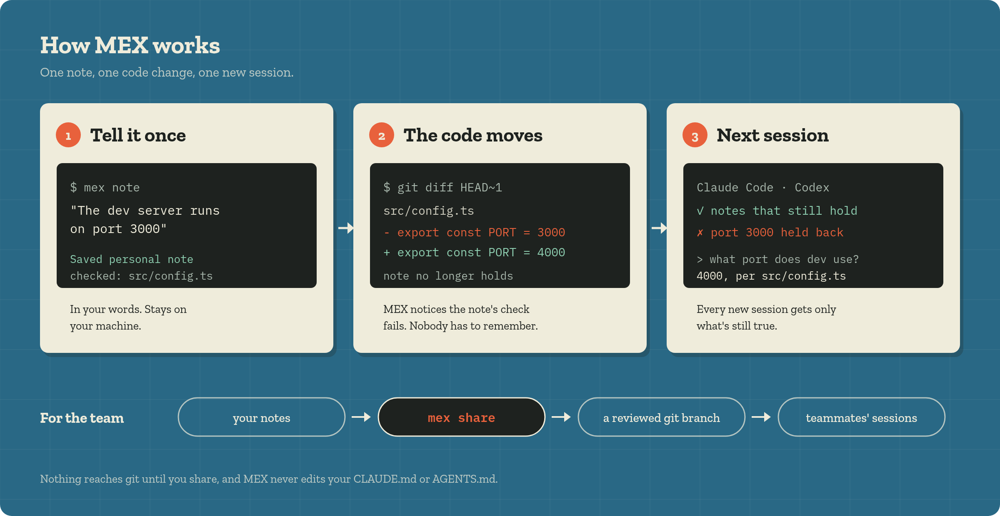

<div align="center">

<h1 id="mex">
  
</h1>

**Tell your agents once. MEX keeps it true.**

Agents forget between sessions, and the notes you leave them go stale when the code moves. MEX delivers your notes to every new Claude Code and Codex session and holds back the ones the code has made false.

**English** | [简体中文](README.zh-CN.md) | [Español](README.es.md) | [Português (Brasil)](README.pt-BR.md)

[](https://www.npmjs.com/package/mex-agent?activeTab=versions)
[](https://www.npmjs.com/package/mex-agent)
[](https://github.com/mex-memory/mex/stargazers)
[](https://mexmemory.com)
[](https://discord.gg/FEdNsQ4Qt4)
[](LICENSE)
[](https://github.com/mex-memory/mex/actions/workflows/ci.yml)
[](package.json)
[](package.json)
[](#install)
[](#install)

[Install](#install) · [What you get](#what-you-get) · [See it work](#see-it-work) · [How it works](#how-it-works) · [Commands](#everyday-commands) · [Teams](#working-with-a-team) · [FAQ](#faq) · [Upgrading from 0.8](#upgrading-from-08)

</div>

> [!NOTE]
> **This is MEX 0.9 beta**, a pre-release on npm's `next` tag. `npm i mex-agent` still installs 0.8.5.
> The beta is a CLI for **Claude Code and Codex**. It has no Hub, MCP server or skills.
> On 0.8? See the [0.8.5 README](https://github.com/mex-memory/mex/blob/v0.8.5/README.md) and [Upgrading from 0.8](#upgrading-from-08).

<!-- VISUAL:V2 -->
<picture>
  <source media="(prefers-color-scheme: light)" srcset="docs/diagrams/readme/first-run-novu-light.gif">
  
</picture>

## Install

Needs Node 22.5 or later (with `node:sqlite`) on Windows, macOS or Linux, plus Claude Code or Codex.

```sh
npm i -g mex-agent@next
cd your-repo
mex
```

Undo: `mex off` (this repo) · `mex uninstall` (everything, keeps notes)

`mex` installs MEX's hooks in your Claude Code and Codex user settings, reads the repo, and shows what your agents get from now on. The first screen makes no model calls and adds nothing to git.

**Codex:** open `/hooks` once in Codex to review and trust MEX's hooks.

Then tell your agents something they keep getting wrong:

```sh
mex note "<something your agents keep getting wrong here, and why>"
# for example:
mex note "Dates are stored in UTC because the reports job compares them across regions"
```

Start a new Claude Code or Codex session and ask about it.

Install globally. MEX won't install hooks from a one-off `npx` run, because npm clears that cache.

## What you get

- **Tell it once.** `mex note` saves a fact, rule or decision in your words. It reaches every new Claude Code and Codex session, through the session start and each agent's own rule files.
- **Never fed stale.** Each note carries checks against the code. When the code makes a note false, MEX holds it back. When the evidence behind it changes, the agent gets a pointer to the current code instead of the old claim.
- **The right moment.** A folder's pitfall arrives when the agent first reads a file there, once. A rule you state in passing ("we always use pnpm here") is repeated to the agent for that turn. Your repo's test and build commands reach the agent without you writing them down.
- **Yours to control.** `mex what` shows what MEX gave or held back this session. `mex off` stops it in a repo. `mex uninstall` restores your settings exactly and keeps your notes.

## See it work

<!-- VISUAL:V3 -->
<picture>
  <source media="(prefers-color-scheme: light)" srcset="docs/diagrams/readme/claude-session-light.gif">
  
</picture>

A note said the dev server runs on port 3000, and Claude answered 3000. Then a commit changed it to 4000. In the next session MEX said the note no longer matched the code and held it back. Claude answered 4000 and called the old 3000 line out of date. Codex, asked the same question in a live run on 17 Nov 2026, answered "unknown" instead of repeating 3000. *(Summary: [release plan](docs/design/0.9.0-release-plan.md).)*

## How it works

<!-- VISUAL:V4 -->
<p align="center"></p>

- **Your notes stay on your machine.** Each one is checked against the code, and a note the code has made false is held back.
- **Each new session gets the notes that still hold,** through Claude Code's and Codex's own hooks and rule files. If MEX fails, your session carries on untouched.
- **MEX never edits your `CLAUDE.md` or `AGENTS.md`.** Its own rule files are git-ignored until you share (see the [FAQ](#faq)).

## Everyday commands

| Command | What it does |
| --- | --- |
| `mex note "<text>"` | Save a note in your words. Checked against the code when saved. |
| `mex recall <words>` | Find a note, with no model call. |
| `mex brief` | Preview what a new session will receive. |
| `mex what` | What MEX gave or held back in this session. |
| `mex check` | Check which notes still hold. Read-only, no AI. |
| `mex check --diff <base>` | The same for a branch, for pre-push or CI. Stores nothing. |
| `mex edit` · `mex wrong` · `mex forget` | Correct a note, retire a wrong one (keeping the reason), or drop it. |
| `mex share` | Preview sharing your notes and rule files on a new git branch. |
| `mex handoff "<line>"` | Leave a handoff for the next person on this branch. |
| `mex doctor` | What MEX is doing here, and a fix for each problem it recorded. |
| `mex off` · `mex on` | Turn MEX off or on in this repo (`--all` for every repo, `--for 2h` to pause). |
| `mex uninstall --dry-run` | List every change MEX made. Without `--dry-run` it restores them and keeps your notes (`--purge` also deletes them). |

Run `mex --help` for the full list.

### When your agent offers to save a note

Each session asks the agent to keep lasting facts, rules or decisions you state, with `mex note`. Your agent will ask you to approve that command like any other. MEX doesn't pre-approve it. Notes the agent saves are labelled `[Claude Code noted, …]` or `[Codex noted, …]` until you `mex edit` them. To save your own words directly, type `mex note: …` in the session.

## Working with a team

Notes are personal until you share them. Sharing is a git branch you review like code:

```sh
mex share                               # preview: a new branch with your notes and rule files
mex share --apply --expect <rev>        # make the branch you previewed
mex share --apply --expect <rev> --pr   # also push it and open a pull request
```

Your current branch is untouched, and nothing is pushed without `--pr`. Each shared note is one Markdown file in the PR:

```markdown
<!-- .mex/learned/mx_f5a7ede674674894feeb10b3.md -->
---
mex:
  id: mx_f5a7ede674674894feeb10b3
  kind: rule
  scope:
    - "**"
  source:
    type: person
    ref: mex note 2026-11-18
    quote: apps/api tests use mocha, not jest, despite the root jest.config.js
  evidence: person
  one_line: apps/api tests use mocha, not jest, despite the root jest.config.js
  checks: []
  status: active
  created: 2026-11-18
---
apps/api tests use mocha, not jest, despite the root jest.config.js
```

A note with checks also lists what it was checked against, with file hashes. The test and build commands MEX found at setup are shared the same way, one file each. The same PR carries the generated rule files: `.claude/rules/mex.md`, a `.claude/rules/mex-area-*.md` for a folder that already has its own `AGENTS.md`, and a new `AGENTS.md` in each other folder that gets commands. It also carries `.mex/config.json`, `.mex/sources.json` and `.mex/native.json`. After it merges, a teammate's Claude Code or Codex session gets the team notes. Each machine keeps its own databases.

`mex handoff` leaves the next person on a branch:
- the branch;
- uncommitted file names;
- your last ask;
- the last failing command;
- one line from you.

It passes a secret scan and is written to `.mex/handoffs/`. You commit it, and MEX never pushes. The next session on that branch gets it once.

## What we tested

Live runs on Windows 11, 17 Nov 2026, with Claude Code 2.1.326 and Codex 0.165. Each was a single run on the sample named. These aren't general claims.

- **Tell it once:** 6 notes saved with `mex note`, then a new session not allowed to use tools. Claude Code answered 6 of 6 from them, and so did Codex. With MEX off, Claude answered "unknown" to 5 of the 6.
- **Across agents:** Claude Code (Sonnet) was told "we always use pnpm in this repo" in passing. It saved the rule with `mex note`, and a new Codex session then answered "pnpm" without tools.

## Privacy, telemetry and cost

- **Your notes stay on your machine** until you share them through a reviewed git branch. MEX has no hosted service and needs no MEX account or API key.
- **Telemetry is on by default.** MEX sends anonymous usage counts: never code, file paths, prompts or repo names. Turn it off with `mex telemetry off` or `DO_NOT_TRACK=1`, and see what's sent with `mex telemetry inspect`. Details: [TELEMETRY.md](TELEMETRY.md).
- **Cost:** `mex` and the first screen are $0. Some background work, like re-checking notes, uses your agent's smallest model on your own plan, within a cap MEX enforces. `mex doctor` shows this week's use. Learning from what you type is **off** until you run `mex config set learning.statements on`.

## FAQ

**Does this replace CLAUDE.md or AGENTS.md?**
No. MEX reads your rule files and flags lines that look out of date, but it never edits them, and it never creates a `CLAUDE.md` or `CLAUDE.local.md`. It writes its own files beside yours: `AGENTS.md` only in folders that have none, and `.claude/rules/mex-*.md` for Claude Code.

**What does MEX write in my repo?**
- **Its generated rule files**, as above. Git ignores them through a MEX block in `.git/info/exclude`.
- **Local files under `.mex/`**, also ignored.

Nothing is tracked until you run `mex share`, which commits `.mex/learned/*.md`, the generated rule files and `.mex/config.json`, `sources.json` and `native.json` on a new branch. `mex handoff` writes `.mex/handoffs/` for you to commit. Your notes and MEX's databases live in MEX's home folder, outside the repo.

**Where did the Hub, the Wiki and MCP go?**
They aren't in the beta. A rebuilt Hub is planned for 0.9.0, and the beta has no MCP server. MEX 0.8.5 is still on npm's `latest` tag with its [README](https://github.com/mex-memory/mex/blob/v0.8.5/README.md). In a 0.8 repo, `mex hub` still opens your 0.8 pages.

## Known limits

- The session-start brief holds your notes up to about 1,000 characters, so a handful of short ones. The rest reach the agent through MEX's rule files.
- A note scoped to some paths is corrected at its next delivery, not at session start.
- Agents keep what you **state**. Things an agent works out on its own aren't saved yet. Smaller Claude models may save a rule to Claude's own memory instead.

## What's coming in 0.9.0

This beta is the first part of 0.9.0. The full release adds:

- **Learning from your history:** notes drawn from pull requests, reviews, CI and commit history, not only from what you state.
- **Deeper checks:** notes checked against what the code means, starting with TypeScript, so more stale notes get caught.
- **The Hub:** a local UI for your notes and your team's.
- **More agents:** Cursor and others, beyond Claude Code and Codex.

## Upgrading from 0.8

```sh
npm i -g mex-agent@next
cd your-0.8-repo
mex upgrade          # preview only
```

The preview lists what becomes notes and what stays as it is. Apply only the exact revision it prints: applying commits to a new local branch and pushes nothing. Add `--pr` only if you want it pushed with a pull request. A section too long for one note (over 8,192 characters) stays in the repo as a file, and the preview says so; save what still matters with `mex note`. Your 0.8 pages still open with `mex hub` while `.mex/ROUTER.md` exists, and `mex doctor --legacy` runs the 0.8 diagnostic. See [COMPATIBILITY.md](COMPATIBILITY.md).

## More

- [Release notes](RELEASE_NOTES.md) · [Changelog](CHANGELOG.md) · [Compatibility](COMPATIBILITY.md) · [Security](SECURITY.md)
- [Discord](https://discord.gg/FEdNsQ4Qt4) · [mexmemory.com](https://mexmemory.com) · [info@mexmemory.com](mailto:info@mexmemory.com)

MIT licensed.
