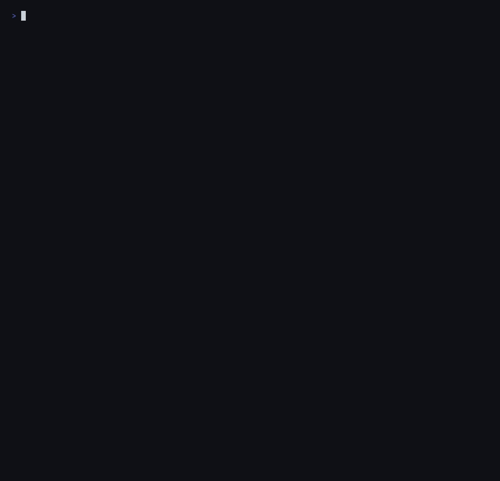
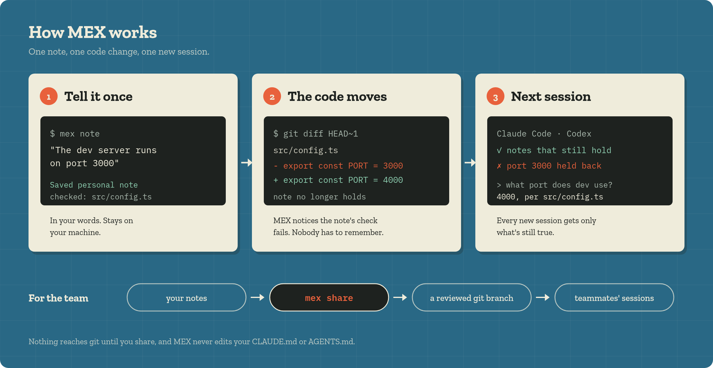

<div align="center">

<h1 id="mex">
  
</h1>

**Diga uma vez aos seus agentes. O MEX mantém isso verdadeiro.**

Agentes esquecem entre sessões, e as notas que você deixa para eles ficam desatualizadas quando o código muda. O MEX entrega suas notas a cada nova sessão do Claude Code e do Codex e segura as que o código tornou falsas.

[English](README.md) | [简体中文](README.zh-CN.md) | [Español](README.es.md) | **Português (Brasil)**

[](https://www.npmjs.com/package/mex-agent?activeTab=versions)
[](https://www.npmjs.com/package/mex-agent)
[](https://github.com/mex-memory/mex/stargazers)
[](https://mexmemory.com)
[](https://discord.gg/FEdNsQ4Qt4)
[](LICENSE)
[](https://github.com/mex-memory/mex/actions/workflows/ci.yml)
[](package.json)
[](package.json)
[](#install)
[](#install)

[Instalação](#install) · [O que você ganha](#what-you-get) · [Veja funcionando](#see-it-work) · [Como funciona](#how-it-works) · [Comandos](#everyday-commands) · [Equipes](#working-with-a-team) · [Perguntas frequentes](#faq) · [Atualizar da 0.8](#upgrading-from-08)

</div>

> [!NOTE]
> **Este é o MEX 0.9 beta**, uma pré-versão na tag `next` do npm. `npm i mex-agent` ainda instala a 0.8.5.
> O beta é uma CLI para **Claude Code e Codex**. Ele não tem Hub, servidor MCP nem skills.
> Está na 0.8? Veja o [README da 0.8.5](https://github.com/mex-memory/mex/blob/v0.8.5/README.pt-BR.md) e [Atualizar da 0.8](#upgrading-from-08).

<picture>
  <source media="(prefers-color-scheme: light)" srcset="docs/diagrams/readme/first-run-novu-light.gif">
  
</picture>

<a id="install"></a>
## Instalação

Requer Node 22.5 ou posterior (com `node:sqlite`) no Windows, macOS ou Linux, além do Claude Code ou do Codex.

```sh
npm i -g mex-agent@next
cd your-repo
mex
```

Desfazer: `mex off` (este repo) · `mex uninstall` (tudo, mantém as notas)

O `mex` instala os hooks do MEX nas configurações de usuário do Claude Code e do Codex, lê o repo e mostra o que seus agentes recebem a partir de agora. A primeira tela não faz chamadas a modelos e não adiciona nada ao git.

**Codex:** revise e confie nos hooks do MEX uma vez: `/hooks` na CLI do Codex, ou **Review hooks** ao lado da caixa de mensagem no app do Codex. Até lá o Codex os ignora, e o MEX não faz nada ali.

Depois, conte aos seus agentes algo que eles vivem errando:

```sh
mex note "<something your agents keep getting wrong here, and why>"
# por exemplo:
mex note "Dates are stored in UTC because the reports job compares them across regions"
```

Inicie uma nova sessão do Claude Code ou do Codex e pergunte sobre isso.

Instale globalmente. O MEX não instala hooks a partir de uma execução avulsa com `npx`, porque o npm limpa esse cache.

<a id="what-you-get"></a>
## O que você ganha

- **Diga uma vez.** `mex note` salva um fato, uma regra ou uma decisão nas suas palavras. Ela chega a cada nova sessão do Claude Code e do Codex, pelo início da sessão e pelos próprios arquivos de regras de cada agente.
- **Nunca desatualizado.** Cada nota traz verificações contra o código. Quando o código torna uma nota falsa, o MEX a segura. Quando a evidência por trás dela muda, o agente recebe um ponteiro para o código atual em vez da afirmação antiga.
- **No momento certo.** Uma armadilha de uma pasta aparece quando o agente lê pela primeira vez um arquivo dela, uma única vez. Uma regra que você diz de passagem ("aqui sempre usamos pnpm") é repetida ao agente naquele turno. Os comandos de teste e build do seu repo chegam ao agente sem que você precise escrevê-los.
- **Você no controle.** `mex what` mostra o que o MEX entregou ou segurou nesta sessão. `mex off` o desliga em um repo. `mex uninstall` restaura suas configurações exatamente e mantém suas notas.

<a id="see-it-work"></a>
## Veja funcionando

<picture>
  <source media="(prefers-color-scheme: light)" srcset="docs/diagrams/readme/claude-session-light.gif">
  
</picture>

Uma nota dizia que o servidor de desenvolvimento roda na porta 3000, e o Claude respondeu 3000. Depois, um commit mudou para 4000. Na sessão seguinte, o MEX disse que a nota não correspondia mais ao código e a segurou. O Claude respondeu 4000 e apontou a linha antiga do 3000 como desatualizada. O Codex, diante da mesma pergunta em uma execução real em 17 de novembro de 2026, respondeu "desconhecido" em vez de repetir 3000. *(Resumo: [plano de lançamento](docs/design/0.9.0-release-plan.md).)*

<a id="how-it-works"></a>
## Como funciona

<p align="center"></p>

- **Suas notas ficam na sua máquina.** Cada uma é verificada contra o código, e uma nota que o código tornou falsa é segurada.
- **Cada nova sessão recebe as notas que continuam valendo**, pelos próprios hooks e arquivos de regras do Claude Code e do Codex. Se o MEX falhar, sua sessão segue sem ser afetada.
- **O MEX nunca edita seu `CLAUDE.md` ou `AGENTS.md`.** Os arquivos de regras dele ficam ignorados pelo git até você compartilhar (veja as [perguntas frequentes](#faq)).

<a id="everyday-commands"></a>
## Comandos do dia a dia

| Comando | O que faz |
| --- | --- |
| `mex note "<text>"` | Salva uma nota nas suas palavras. Verificada contra o código ao salvar. |
| `mex recall <words>` | Encontra uma nota, sem chamar modelo. |
| `mex brief` | Mostra o que uma nova sessão vai receber. |
| `mex what` | O que o MEX entregou ou segurou nesta sessão. |
| `mex check` | Verifica quais notas continuam valendo. Somente leitura, sem IA. |
| `mex check --diff <base>` | O mesmo para uma branch, para pre-push ou CI. Não armazena nada. |
| `mex edit` · `mex wrong` · `mex forget` | Corrige uma nota, retira uma errada (guardando o motivo) ou a descarta. |
| `mex share` | Mostra uma prévia de como compartilhar suas notas e arquivos de regras em uma nova branch git. |
| `mex handoff "<line>"` | Deixa uma passagem de bastão para a próxima pessoa nesta branch. |
| `mex doctor` | O que o MEX está fazendo aqui, e uma correção para cada problema que ele registrou. |
| `mex off` · `mex on` | Desliga ou liga o MEX neste repo (`--all` para todos os repos, `--for 2h` para pausar). |
| `mex uninstall --dry-run` | Lista cada mudança que o MEX fez. Sem `--dry-run`, ele as desfaz e mantém suas notas (`--purge` também as apaga). |

Rode `mex --help` para ver a lista completa.

### Quando seu agente oferece salvar uma nota

Cada sessão pede ao agente que guarde, com `mex note`, fatos, regras ou decisões duradouros que você disser. Seu agente vai pedir que você aprove esse comando como qualquer outro; o MEX não o aprova de antemão. Notas salvas pelo agente aparecem como `[Claude Code noted, …]` ou `[Codex noted, …]` até você editá-las com `mex edit`. Para salvar suas próprias palavras diretamente, digite `mex note: …` na sessão.

<a id="working-with-a-team"></a>
## Trabalhando em equipe

As notas são pessoais até você compartilhá-las. Compartilhar é uma branch git que você revisa como código:

```sh
mex share                               # prévia: uma nova branch com suas notas e arquivos de regras
mex share --apply --expect <rev>        # cria a branch que você viu na prévia
mex share --apply --expect <rev> --pr   # também faz push e abre um pull request
```

Sua branch atual não é alterada, e nada é enviado sem `--pr`. Cada nota compartilhada é um arquivo Markdown no PR:

```markdown
<!-- .mex/learned/mx_f5a7ede674674894feeb10b3.md -->
---
mex:
  id: mx_f5a7ede674674894feeb10b3
  kind: rule
  scope:
    - "**"
  source:
    type: person
    ref: mex note 2026-11-18
    quote: apps/api tests use mocha, not jest, despite the root jest.config.js
  evidence: person
  one_line: apps/api tests use mocha, not jest, despite the root jest.config.js
  checks: []
  status: active
  created: 2026-11-18
---
apps/api tests use mocha, not jest, despite the root jest.config.js
```

Uma nota com verificações também lista contra o que foi verificada, com hashes de arquivo. Os comandos de teste e build que o MEX encontrou na configuração são compartilhados do mesmo jeito, um arquivo cada. O mesmo PR leva os arquivos de regras gerados: `.claude/rules/mex.md`, um `.claude/rules/mex-area-*.md` para uma pasta que já tem seu próprio `AGENTS.md`, e um novo `AGENTS.md` em cada outra pasta que recebe comandos. Ele também leva `.mex/config.json`, `.mex/sources.json` e `.mex/native.json`. Depois do merge, a sessão do Claude Code ou do Codex de um colega recebe as notas da equipe. Cada máquina mantém seus próprios bancos de dados.

`mex handoff` deixa para a próxima pessoa em uma branch:
- a branch;
- os nomes dos arquivos sem commit;
- seu último pedido;
- o último comando que falhou;
- uma linha sua.

Ele passa por uma varredura de segredos e é gravado em `.mex/handoffs/`. Você faz o commit; o MEX nunca faz push. A próxima sessão nessa branch o recebe uma vez.

## O que testamos

Execuções reais no Windows 11, em 17 de novembro de 2026, com Claude Code 2.1.326 e Codex 0.165. Cada uma foi uma única execução na amostra indicada. Não são afirmações gerais.

- **Diga uma vez:** 6 notas salvas com `mex note` e, em seguida, uma nova sessão sem permissão para usar ferramentas. O Claude Code respondeu 6 de 6 a partir delas, e o Codex também. Com o MEX desligado, o Claude respondeu "desconhecido" a 5 das 6.
- **Entre agentes:** o Claude Code (Sonnet) ouviu de passagem "neste repo sempre usamos pnpm". Ele salvou a regra com `mex note`, e uma nova sessão do Codex depois respondeu "pnpm" sem ferramentas.

## Privacidade, telemetria e custo

- **Suas notas ficam na sua máquina** até você compartilhá-las por uma branch git revisada. O MEX não tem serviço hospedado e não precisa de conta no MEX nem de chave de API.
- **A telemetria vem ligada por padrão.** O MEX envia contagens de uso anônimas: nunca código, caminhos de arquivo, prompts ou nomes de repo. Desligue com `mex telemetry off` ou `DO_NOT_TRACK=1`, e veja o que é enviado com `mex telemetry inspect`. Detalhes: [TELEMETRY.md](TELEMETRY.md).
- **Custo:** `mex` e a primeira tela custam $0. Parte do trabalho em segundo plano, como reverificar notas, usa o menor modelo do seu agente no seu próprio plano, dentro de um limite que o MEX impõe. `mex doctor` mostra o uso da semana. Aprender com o que você digita fica **desligado** até você rodar `mex config set learning.statements on`.

<a id="faq"></a>
## Perguntas frequentes

**Isso substitui o CLAUDE.md ou o AGENTS.md?**
Não. O MEX lê seus arquivos de regras e sinaliza linhas que parecem desatualizadas, mas nunca os edita e nunca cria um `CLAUDE.md` ou `CLAUDE.local.md`. Ele grava os próprios arquivos ao lado dos seus: `AGENTS.md` só em pastas que não têm um, e `.claude/rules/mex-*.md` para o Claude Code.

**O que o MEX grava no meu repo?**
- **Os arquivos de regras gerados por ele**, como acima. O git os ignora por meio de um bloco do MEX em `.git/info/exclude`.
- **Arquivos locais em `.mex/`**, também ignorados.

Nada é rastreado até você rodar `mex share`, que faz commit de `.mex/learned/*.md`, dos arquivos de regras gerados e de `.mex/config.json`, `sources.json` e `native.json` em uma nova branch. `mex handoff` grava `.mex/handoffs/` para você fazer o commit. Suas notas e os bancos de dados do MEX ficam na pasta do MEX, fora do repo.

**Para onde foram o Hub, a Wiki e o MCP?**
Eles não estão no beta. Um Hub reconstruído está previsto para a 0.9.0, e o beta não tem servidor MCP. O MEX 0.8.5 continua na tag `latest` do npm, com o seu [README](https://github.com/mex-memory/mex/blob/v0.8.5/README.pt-BR.md). Em um repo 0.8, `mex hub` continua abrindo suas páginas da 0.8.

## Limitações conhecidas

- O resumo de início de sessão comporta suas notas até cerca de 1.000 caracteres, ou seja, algumas notas curtas. O restante chega ao agente pelos arquivos de regras do MEX.
- Uma nota restrita a alguns caminhos é corrigida na próxima entrega, não no início da sessão.
- Os agentes guardam o que você **diz**. O que um agente descobre sozinho ainda não é salvo. Modelos menores do Claude podem salvar uma regra na memória do próprio Claude em vez de no MEX.

## O que vem na 0.9.0

Este beta é a primeira parte da 0.9.0. A versão completa acrescenta:

- **Aprender com o seu histórico:** notas tiradas de pull requests, revisões, CI e histórico de commits, não só do que você diz.
- **Verificações mais profundas:** notas verificadas contra o que o código significa, começando pelo TypeScript, para pegar mais notas desatualizadas.
- **O Hub:** uma interface local para as suas notas e as da sua equipe.
- **Mais agentes:** Cursor e outros, além do Claude Code e do Codex.

<a id="upgrading-from-08"></a>
## Atualizar da 0.8

```sh
npm i -g mex-agent@next
cd your-0.8-repo
mex upgrade          # só a prévia
```

A prévia lista o que vira nota e o que fica como está. Aplique apenas a revisão exata que ela imprime: aplicar faz commit em uma nova branch local e não envia nada. Adicione `--pr` só se quiser enviá-la com um pull request. Uma seção longa demais para uma nota (mais de 8.192 caracteres) fica no repo como arquivo, e a prévia avisa; salve o que ainda importa com `mex note`. Suas páginas da 0.8 continuam abrindo com `mex hub` enquanto `.mex/ROUTER.md` existir, e `mex doctor --legacy` roda o diagnóstico da 0.8. Veja [COMPATIBILITY.md](COMPATIBILITY.md).

## Mais

- [Notas da versão](RELEASE_NOTES.md) · [Changelog](CHANGELOG.md) · [Compatibilidade](COMPATIBILITY.md) · [Segurança](SECURITY.md)
- [Discord](https://discord.gg/FEdNsQ4Qt4) · [mexmemory.com](https://mexmemory.com) · [info@mexmemory.com](mailto:info@mexmemory.com)

Licença MIT.
