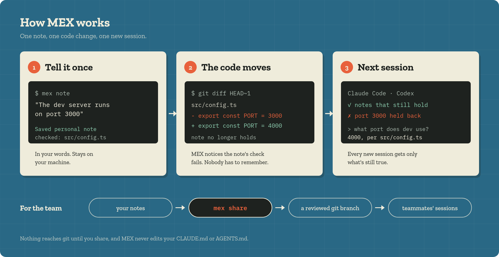

<div align="center">

<h1 id="mex">
  
</h1>

**告诉智能体一次，MEX 让它一直正确。**

智能体在会话之间会遗忘，你留给它们的笔记也会随着代码变化而过时。MEX 把你的笔记送到每个新的 Claude Code 和 Codex 会话中，并扣下那些已被代码证伪的笔记。

[English](README.md) | **简体中文** | [Español](README.es.md) | [Português (Brasil)](README.pt-BR.md)

[](https://www.npmjs.com/package/mex-agent?activeTab=versions)
[](https://www.npmjs.com/package/mex-agent)
[](https://github.com/mex-memory/mex/stargazers)
[](https://mexmemory.com)
[](https://discord.gg/FEdNsQ4Qt4)
[](LICENSE)
[](https://github.com/mex-memory/mex/actions/workflows/ci.yml)
[](package.json)
[](package.json)
[](#install)
[](#install)

[安装](#install) · [你能得到什么](#what-you-get) · [实际效果](#see-it-work) · [工作原理](#how-it-works) · [命令](#everyday-commands) · [团队](#working-with-a-team) · [常见问题](#faq) · [从 0.8 升级](#upgrading-from-08)

</div>

> [!NOTE]
> **这是 MEX 0.9 beta**，发布在 npm 的 `next` 标签上的预发布版。`npm i mex-agent` 仍然安装 0.8.5。
> 这个 beta 是面向 **Claude Code 和 Codex** 的命令行工具，不包含 Hub、MCP 服务器或技能（skills）。
> 还在用 0.8？请看 [0.8.5 版 README](https://github.com/mex-memory/mex/blob/v0.8.5/README.zh-CN.md) 和[从 0.8 升级](#upgrading-from-08)。

<picture>
  <source media="(prefers-color-scheme: light)" srcset="docs/diagrams/readme/first-run-novu-light.gif">
  
</picture>

<a id="install"></a>
## 安装

需要 Node 22.5 或更高版本（带 `node:sqlite`），支持 Windows、macOS 和 Linux，并需要 Claude Code 或 Codex。

```sh
npm i -g mex-agent@next
cd your-repo
mex
```

撤销：`mex off`（当前仓库）· `mex uninstall`（全部，保留笔记）

`mex` 会在你的 Claude Code 和 Codex 用户设置中安装 MEX 的钩子，读取仓库，并显示从现在起智能体会得到什么。首屏不调用任何模型，也不向 git 添加任何内容。

**Codex：** 在 Codex 中打开一次 `/hooks`，查看并信任 MEX 的钩子。

然后告诉智能体一件它们总是弄错的事：

```sh
mex note "<something your agents keep getting wrong here, and why>"
# 例如：
mex note "Dates are stored in UTC because the reports job compares them across regions"
```

开启一个新的 Claude Code 或 Codex 会话，问问它这件事。

请全局安装。用一次性的 `npx` 运行时，MEX 不会安装钩子，因为 npm 会清理那个缓存。

<a id="what-you-get"></a>
## 你能得到什么

- **说一次就够。** `mex note` 用你自己的话保存一条事实、规则或决定。它会通过会话开始时的简报和各智能体自己的规则文件，送到每个新的 Claude Code 和 Codex 会话。
- **不喂过时的内容。** 每条笔记都带有针对代码的检查。代码让笔记失效时，MEX 会扣下它；笔记依据的内容变了时，智能体得到的是指向当前代码的提示，而不是旧的说法。
- **在对的时刻出现。** 某个文件夹的坑，会在智能体第一次读取那里的文件时出现一次。你随口说出的规则（“这里我们一直用 pnpm”）会在那一轮里再提醒智能体一次。仓库的测试和构建命令无需你写下来，也会送到智能体。
- **由你掌控。** `mex what` 显示本次会话中 MEX 给出或扣下了什么。`mex off` 在某个仓库停用它。`mex uninstall` 完整恢复你的设置并保留你的笔记。

<a id="see-it-work"></a>
## 实际效果

<picture>
  <source media="(prefers-color-scheme: light)" srcset="docs/diagrams/readme/claude-session-light.gif">
  
</picture>

一条笔记说开发服务器运行在 3000 端口，Claude 回答了 3000。随后一次提交把它改成了 4000。在下一个会话中，MEX 指出这条笔记与代码不再一致并把它扣下。Claude 回答 4000，并指出旧的 3000 那条已经过时。2026 年 11 月 17 日的一次实测中，Codex 被问到同样的问题时回答“不知道”，而不是重复 3000。*（概要：[发布计划](docs/design/0.9.0-release-plan.md)。）*

<a id="how-it-works"></a>
## 工作原理

<p align="center"></p>

- **你的笔记留在你的机器上。** 每条笔记都会对照代码检查，被代码证伪的笔记会被扣下。
- **每个新会话都会得到仍然成立的笔记**，通过 Claude Code 和 Codex 自己的钩子和规则文件送达。即使 MEX 出错，你的会话也照常进行、不受影响。
- **MEX 从不编辑你的 `CLAUDE.md` 或 `AGENTS.md`。** 它自己的规则文件在你共享之前都被 git 忽略（见[常见问题](#faq)）。

<a id="everyday-commands"></a>
## 常用命令

| 命令 | 作用 |
| --- | --- |
| `mex note "<text>"` | 用你的话保存一条笔记，保存时即对照代码检查。 |
| `mex recall <words>` | 查找笔记，不调用模型。 |
| `mex brief` | 预览新会话会收到的内容。 |
| `mex what` | 本次会话中 MEX 给出或扣下了什么。 |
| `mex check` | 检查哪些笔记仍然成立。只读，不用 AI。 |
| `mex check --diff <base>` | 对一个分支做同样的检查，用于 pre-push 或 CI。不存储任何内容。 |
| `mex edit` · `mex wrong` · `mex forget` | 修正一条笔记、撤下一条错误的笔记（保留原因），或删掉它。 |
| `mex share` | 预览在新的 git 分支上共享你的笔记和规则文件。 |
| `mex handoff "<line>"` | 给这个分支上的下一个人留一份交接。 |
| `mex doctor` | MEX 在这里做什么，以及它记录到的每个问题的解决办法。 |
| `mex off` · `mex on` | 在这个仓库关闭或开启 MEX（`--all` 作用于所有仓库，`--for 2h` 暂停）。 |
| `mex uninstall --dry-run` | 列出 MEX 做过的每一处改动。不带 `--dry-run` 时会还原这些改动并保留笔记（`--purge` 会一并删除笔记）。 |

运行 `mex --help` 查看完整列表。

### 当智能体提出要保存笔记时

每个会话都会请智能体用 `mex note` 记下你说出的长期有效的事实、规则或决定。智能体会像对待其他命令一样请你批准这个命令，MEX 不会预先批准它。智能体保存的笔记会标为 `[Claude Code noted, …]` 或 `[Codex noted, …]`，直到你用 `mex edit` 修改它们。想直接保存你自己的原话，在会话里输入 `mex note: …`。

<a id="working-with-a-team"></a>
## 团队协作

在你共享之前，笔记都是个人的。共享就是一个像代码一样审查的 git 分支：

```sh
mex share                               # 预览：一个包含你的笔记和规则文件的新分支
mex share --apply --expect <rev>        # 创建你预览过的分支
mex share --apply --expect <rev> --pr   # 同时推送并发起 pull request
```

你当前的分支不受影响，不加 `--pr` 就不会推送任何内容。每条共享的笔记在 PR 中是一个 Markdown 文件：

```markdown
<!-- .mex/learned/mx_f5a7ede674674894feeb10b3.md -->
---
mex:
  id: mx_f5a7ede674674894feeb10b3
  kind: rule
  scope:
    - "**"
  source:
    type: person
    ref: mex note 2026-11-18
    quote: apps/api tests use mocha, not jest, despite the root jest.config.js
  evidence: person
  one_line: apps/api tests use mocha, not jest, despite the root jest.config.js
  checks: []
  status: active
  created: 2026-11-18
---
apps/api tests use mocha, not jest, despite the root jest.config.js
```

带检查的笔记还会列出它对照检查过的内容及文件哈希。MEX 在初始化时找到的测试和构建命令也以同样方式共享，每条一个文件。同一个 PR 还包含生成的规则文件：`.claude/rules/mex.md`；对已有自己 `AGENTS.md` 的文件夹，生成 `.claude/rules/mex-area-*.md`；对其他需要命令的文件夹，各生成一个新的 `AGENTS.md`。它还包含 `.mex/config.json`、`.mex/sources.json` 和 `.mex/native.json`。合并之后，队友的 Claude Code 或 Codex 会话就会得到团队笔记。每台机器各自保留自己的数据库。

`mex handoff` 给这个分支上的下一个人留下：
- 分支；
- 未提交的文件名；
- 你最后的请求；
- 最后一个失败的命令；
- 你写的一行话。

它会通过机密信息扫描，并写入 `.mex/handoffs/`。由你提交，MEX 从不推送。这个分支上的下一个会话会收到它一次。

## 我们测试了什么

2026 年 11 月 17 日在 Windows 11 上的实测，使用 Claude Code 2.1.326 和 Codex 0.165。每项都只是在所列样本上的一次运行，不代表普遍结论。

- **说一次就够：** 用 `mex note` 保存 6 条笔记，然后开启一个不允许使用工具的新会话。Claude Code 依据笔记答对 6 题中的 6 题，Codex 也一样。关闭 MEX 后，Claude 对其中 5 题回答“不知道”。
- **跨智能体：** 在对话中顺口告诉 Claude Code（Sonnet）“这个仓库我们一直用 pnpm”。它用 `mex note` 保存了这条规则，随后一个新的 Codex 会话在不用工具的情况下回答了“pnpm”。

## 隐私、遥测与费用

- **你的笔记留在你的机器上**，直到你通过经过审查的 git 分支共享它们。MEX 没有托管服务，不需要 MEX 账号或 API 密钥。
- **遥测默认开启。** MEX 发送匿名的使用计数：从不包含代码、文件路径、提示词或仓库名。用 `mex telemetry off` 或 `DO_NOT_TRACK=1` 关闭，用 `mex telemetry inspect` 查看发送的内容。详情：[TELEMETRY.md](TELEMETRY.md)。
- **费用：** `mex` 和首屏都是 $0。一些后台工作（比如重新检查笔记）会在你自己的套餐内使用智能体最小的模型，并受 MEX 强制执行的上限约束。`mex doctor` 显示本周的用量。从你输入的内容中学习默认**关闭**，直到你运行 `mex config set learning.statements on`。

<a id="faq"></a>
## 常见问题

**它会取代 CLAUDE.md 或 AGENTS.md 吗？**
不会。MEX 会读取你的规则文件并标出看起来过时的内容，但从不编辑它们，也从不创建 `CLAUDE.md` 或 `CLAUDE.local.md`。它把自己的文件写在你的文件旁边：只在没有 `AGENTS.md` 的文件夹里写 `AGENTS.md`，为 Claude Code 写 `.claude/rules/mex-*.md`。

**MEX 会在我的仓库里写什么？**
- **它生成的规则文件**，如上所述。git 通过 `.git/info/exclude` 中的一个 MEX 区块忽略它们。
- **`.mex/` 下的本地文件**，同样被忽略。

在你运行 `mex share` 之前，什么都不会被跟踪；`mex share` 会在新分支上提交 `.mex/learned/*.md`、生成的规则文件，以及 `.mex/config.json`、`sources.json` 和 `native.json`。`mex handoff` 写入 `.mex/handoffs/`，由你提交。你的笔记和 MEX 的数据库保存在仓库之外的 MEX 主目录中。

**Hub、Wiki 和 MCP 去哪了？**
它们不在这个 beta 里。重建的 Hub 计划在 0.9.0 推出，beta 没有 MCP 服务器。MEX 0.8.5 仍在 npm 的 `latest` 标签上，见它的 [README](https://github.com/mex-memory/mex/blob/v0.8.5/README.zh-CN.md)。在 0.8 的仓库里，`mex hub` 仍会打开你的 0.8 页面。

## 已知限制

- 会话开始时的简报最多容纳约 1,000 个字符的笔记，也就是几条简短的笔记。其余的通过 MEX 的规则文件送达智能体。
- 限定在某些路径上的笔记，会在下一次送达时修正，而不是在会话开始时。
- 智能体会记住你**说出**的内容。智能体自己推断出的东西目前还不会保存。较小的 Claude 模型可能会把规则存进 Claude 自己的记忆，而不是 MEX。

## 0.9.0 将带来什么

这个 beta 是 0.9.0 的第一部分。完整版本会加入：

- **从历史中学习：** 从 pull request、代码审查、CI 和提交历史中提炼笔记，而不只是来自你说的话。
- **更深入的检查：** 对照代码的含义检查笔记，从 TypeScript 开始，从而发现更多过时的笔记。
- **Hub：** 用于查看你和团队笔记的本地界面。
- **更多智能体：** 在 Claude Code 和 Codex 之外，支持 Cursor 等。

<a id="upgrading-from-08"></a>
## 从 0.8 升级

```sh
npm i -g mex-agent@next
cd your-0.8-repo
mex upgrade          # 仅预览
```

预览会列出哪些内容会变成笔记、哪些保持原样。只应用它打印出的那个确切修订：应用会提交到一个新的本地分支，不推送任何内容。只有当你希望推送并发起 pull request 时才加 `--pr`。太长、放不进一条笔记的段落（超过 8,192 个字符）会作为文件留在仓库里，预览会说明这一点；仍然重要的内容请用 `mex note` 保存。只要 `.mex/ROUTER.md` 还在，你的 0.8 页面仍可用 `mex hub` 打开，`mex doctor --legacy` 会运行 0.8 的诊断。见 [COMPATIBILITY.md](COMPATIBILITY.md)。

## 更多

- [发布说明](RELEASE_NOTES.md) · [更新日志](CHANGELOG.md) · [兼容性](COMPATIBILITY.md) · [安全](SECURITY.md)
- [Discord](https://discord.gg/FEdNsQ4Qt4) · [mexmemory.com](https://mexmemory.com) · [info@mexmemory.com](mailto:info@mexmemory.com)

MIT 许可证。
